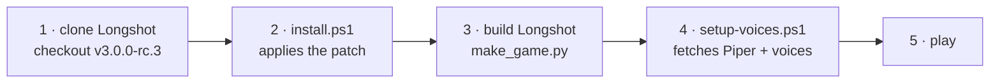
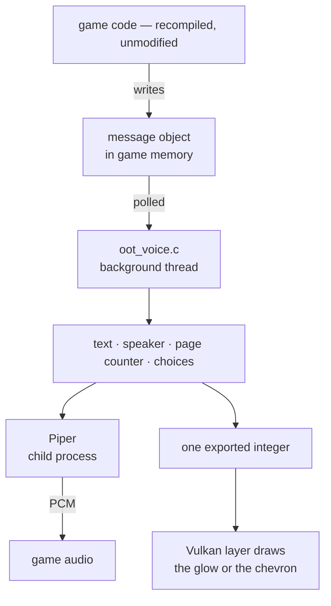

# Longshot-Narrator

[](https://github.com/Predator04/Longshot-Narrator/releases/latest)
[](https://github.com/Predator04/Longshot-Narrator/releases)
[](LICENSE)


**Read-aloud dialogue for [Longshot](https://git.magicbean.dev/MagicBeanDev/Longshot)** — the PC version of *The
Legend of Zelda: Ocarina of Time* (Nintendo Switch 2) that you build from your own copy of the game.

Longshot-Narrator speaks every dialogue box aloud as it appears, gives each character a voice that suits them, and
reads Link's reply choices in a voice of his own.

> It was written for a five-year-old who wanted to play a game she couldn't read.
> That one requirement — *she must never be stuck wondering whether it's her turn* — shaped most of the decisions
> below, including the on-screen cues and the rule about when a line counts as already heard.

> [!IMPORTANT]
> This repository contains **no game files, no ROM, no keys, no executable and no voice recordings**. It is a
> source patch of about 1,300 lines. You supply Longshot, built from your own copy of the game. All speech is
> generated on your PC as you play — nothing is sent anywhere.

---

## Contents

| | | |
|---|---|---|
| [What it does](#what-it-does) | [Settings](#settings) | [Requirements](#requirements) |
| [Install](#install) | [How it works](#how-it-works) | [What the patch changes](#what-the-patch-changes) |
| [FAQ](#faq) | [Known limitations](#known-limitations) | [Troubleshooting](#troubleshooting) |
| [Architecture](docs/ARCHITECTURE.md) | [Changelog](CHANGELOG.md) | [Contributing](CONTRIBUTING.md) |

---

## What it does

**Reading**

- **Every dialogue box is read aloud** when it appears, page by page.
- **Character voices.** Each character gets a man's, woman's, boy's or girl's voice chosen to match their model,
  and keeps that same voice every time you meet them. A character the table doesn't know gets the narrator's
  voice rather than silence.
- **Expression.** Lines ending in `!` sound more excited, questions rise at the end, and `...` becomes a pause.
- **Numbers the game fills in are spoken** as part of the line — *"Only **7** left to find!"* — resolved from the
  game's own save data, not read as a placeholder.

**Choices**

- **Link's voice for the reply menu.** Only the *highlighted* choice is read — reading the whole list takes too
  long and buries the one the cursor is on. Moving the cursor stops the current line and reads the one you land on.
- **A chevron points at the menu**, so a player who can't read can tell the game is asking them something rather
  than still talking.

**Knowing when to press**

- **A glow round the screen's edge** once a page has been read.
- **Both cues can be one steady colour** instead of the rainbow, which is calmer over a long session.

**Staying out of the way**

- **No repeats, and no silence.** A line you just heard isn't read again when a conversation loops back to it —
  but talking to someone a second time starts afresh, so you always hear their opening line. ([Why that's harder
  than it sounds](#why-is-knowing-when-a-conversation-ends-a-hard-problem))
- **The game's own voice acting is left alone.** Where the game voices a line itself, the narrator stays quiet.
- **Nothing blocks the frame.** Speech is synthesised in a separate process and queued to the game's audio.

## Settings

In the game's menu (**Insert** or **F1**), under the **Audio** tab. Changes take effect immediately.

| Setting | Choices | Default | What it does |
|---|---|---|---|
| **Read aloud** | On / Off | On | Turns read-aloud on or off. |
| **Read-aloud voice** | Natural / Windows / Custom | Natural | *Natural* is the lifelike voice ([Piper](https://github.com/rhasspy/piper), running on your PC). *Windows* is the voice built into Windows, used automatically if Piper isn't installed. *Custom* uses one Piper voice of your own for every line — put its `.onnx` and `.onnx.json` in `piper\custom` next to `longshot.exe`. |
| **Read-aloud speed** | 50% – 200% | 100% | How fast lines are read. |
| **Press-next glow** | Off / Screen edge / Arrow / Both | Both | *Screen edge*: the picture's rim glows once a page has been read. *Arrow*: a chevron points at a reply menu. *Both* does each. |
| **Glow colour** | Rainbow / Gold / Green / Blue / Purple / Pink | Rainbow | *Rainbow* keeps turning through every hue; any other holds one colour still. (Gold is the subtlest — against sandy scenery it can almost disappear.) |
| **Link's voice** | Voice 1 – 16 | Voice 1 | Which voice reads Link's choices. Changing it plays a sample. |
| **Link's voice pitch** | Normal, +1 – +6 | +3 | How much higher Link's voice is, in semitones, so he sounds younger. Changing it plays a sample. |

Settings are saved in `longshot_options.ini` alongside Longshot's own. Starting the game with `HOS_VOICE=0` turns
read-aloud off entirely.

## Requirements

| | |
|---|---|
| **OS** | Windows, 64-bit |
| **Longshot** | **v3.0.0-rc.3**, built from source |
| **Game** | Your own copy. Nothing here supplies it |
| **Git** | [Git for Windows](https://git-scm.com), to apply the patch |
| **Voices** | [Piper](https://github.com/rhasspy/piper) and two models, ~157 MB — fetched by `setup-voices.ps1` |
| **Disk** | ~160 MB beyond Longshot's own needs |

Read-aloud works **without** Piper by using the Windows voice; Piper is what makes it sound natural.

> [!NOTE]
> Longshot has no stable release yet, so this patch is cut against a specific release candidate and will not apply
> to a different one. `install.ps1` tells you which version you're on if it doesn't fit, and the
> [changelog](CHANGELOG.md) records which release targets which version.

---

## Install



### 1. Get Longshot

```powershell
git clone https://git.magicbean.dev/MagicBeanDev/Longshot
cd Longshot
git checkout v3.0.0-rc.3
```

Longshot is developed by Team MagicBean on their own server at
[git.magicbean.dev](https://git.magicbean.dev/MagicBeanDev/Longshot), not on GitHub.

### 2. Add Longshot-Narrator

Download [the latest release](https://github.com/Predator04/Longshot-Narrator/releases/latest), unzip it, open
PowerShell in that folder and run:

```powershell
powershell -ExecutionPolicy Bypass -File .\install.ps1 -Longshot "C:\path\to\Longshot"
```

It only edits Longshot's source. Nothing is downloaded and no game files are touched. It says so if the add-on is
already installed, and names the version you're on if the patch doesn't fit.

### 3. Build Longshot

Build as Longshot's own documentation describes, for example:

```powershell
python -I nx2/make_game.py --nup "C:\path\your-game.nup" --out "C:\Games\Longshot" --language en-US
```

### 4. Add the natural voices

Point this at your **built game folder** — the one you passed to `--out`, holding `longshot.exe`:

```powershell
powershell -ExecutionPolicy Bypass -File .\setup-voices.ps1 -Game "C:\Games\Longshot"
```

It fetches Piper and both voices (~157 MB) into `<game>\piper`. Anything already there and the right size is left
alone, so a dropped download is fixed by running it again. `-Check` reports what's missing without downloading.

<details>
<summary>Or do it by hand</summary>

1. Download `piper_windows_amd64.zip` from [Piper's releases](https://github.com/rhasspy/piper/releases) (release
   2023.11.14-2). It contains a `piper` folder; unzip it next to `longshot.exe`, so you have
   `C:\Games\Longshot\piper\piper.exe`.
2. Download these two voices from [rhasspy/piper-voices](https://huggingface.co/rhasspy/piper-voices/tree/main/en/en_US),
   both the `.onnx` and its `.onnx.json`, into that same `piper` folder:

   | File | Used for | Size |
   |---|---|---|
   | `en_US-lessac-medium.onnx` + `.onnx.json` | the narrator (characters it doesn't recognise) | ~63 MB |
   | `en_US-libritts_r-medium.onnx` + `.onnx.json` | the character voices and Link's | ~79 MB |

</details>

Either way, check each voice's licence on its model card before you use it.

### 5. Play

Start the game and talk to anyone. Settings are under **Insert → Audio**.

---

## How it works

Longshot translates the game's original ARM64 code into C and runs it natively. The game's dialogue system is
therefore *the game's own*, unmodified — and it doesn't announce anything. There's no event to subscribe to.

So the add-on observes. A background thread watches the structure the dialogue system uses, and reacts when it
changes.



- **Finding the text.** A fixed pointer in the game's data leads to the message on show. Its text, message id,
  choice count and page counter all sit at known offsets.
- **Who's speaking.** The message points at the event's cast; the first character entry gives a model name, and
  the name picks the voice. Note it's the *event's* cast — a scene can list characters who never speak.
- **Conversation boundaries** come from the page counter, not from timing. See the [FAQ](#why-is-knowing-when-a-conversation-ends-a-hard-problem).
- **Filled-in values** are resolved from the game's save-data manager so numbers are spoken correctly.
- **The game's own voice acting** is detected by watching for the game opening its voice streams.
- **Speech** runs in a child process, so synthesis never blocks a frame.
- **The cues** are driven by a single integer the renderer reads once a frame. That's the entire interface between
  the two halves.

**[Full technical detail in docs/ARCHITECTURE.md →](docs/ARCHITECTURE.md)**

## What the patch changes

Nine files, about 1,300 added lines. Most of it is one new file; the rest are a few lines each.

| File | Lines | What it does |
|---|---|---|
| `host/oot_voice.c` | +977 | **New.** Polling, speaker lookup, conversation tracking, speech, the cue flags |
| `host/oot_voice_cast.h` | +196 | **New.** The character-to-voice table |
| `host/nn_fs.c` | +10 | Notices the game's own voiced lines so the narrator stays quiet |
| `host/hos_main.c` | +4 | Hands the narrator the save-data manager, for filled-in values |
| `host/oot_text_size.c` | +4 | Keeps text handling in step |
| `gpu/vk/vk_api.h` | +4 | Option ids for the Audio rows |
| `gpu/vk/vk_menu.h` | +7 | The settings themselves |
| `gpu/vk/vk_menu.cpp` | +131 | The Audio rows, and drawing the glow and the chevron |
| `gpu/vk/vk_replay.cpp` | +6 | Passes settings from the menu to the host |

`install.ps1 -Uninstall` reverses all of it exactly, leaving the source as it was.

## FAQ

### Does it send anything over the internet?

No. All speech is generated on your PC by Piper, a local neural voice. The add-on opens no network connection at
runtime. The only downloads are Piper and the voice models, fetched once by `setup-voices.ps1` from the Piper
project and Hugging Face.

### Does it slow the game down?

It shouldn't. Synthesis runs in a **separate process**, so it can't stall a frame. The add-on's own work is a
background thread reading a handful of values, and the renderer's share is one integer read per frame plus the
cue itself when one is showing.

### Why is knowing when a conversation ends a hard problem?

Because the obvious answer doesn't work. You might treat a long enough gap as a new conversation — but the
dialogue box closes briefly mid-conversation for ordinary reasons, and those gaps overlap with real ones:

| | |
|---|---|
| Longest gap measured *within* one conversation | **2916 ms** |
| Shortest gap measured *between* two conversations | **1406 ms** |

No threshold separates them. The page counter does: while the box is shut, a counter that dropped to zero means
the conversation ended, and one holding its value means it's merely paused. That rule is why an opening line isn't
repeated when a conversation loops, yet *is* read again when you genuinely talk to someone a second time.

### Can I use my own voice?

Yes — train a Piper voice from recordings of yourself and point the add-on at it. See
[Using other voices](#using-other-voices-or-your-own). Only train on a voice that's yours, or one whose owner
agreed.

### Why does the log say "Windows voice" when Piper is working?

That line reports the SAPI fallback being initialised at startup, which always happens. Piper is started lazily,
the first time a line is spoken — look for `natural voice (piper, …)` after talking to someone.

### Will it work on a newer Longshot?

Not without a rebuild. The patch is cut against one version. Porting is usually straightforward —
[the architecture doc explains what to watch for](docs/ARCHITECTURE.md#porting-to-a-new-longshot-version).

## Known limitations

- **One Longshot version per release.** The patch won't apply to a different one.
- **English only.** The voice models and the expression rules are English.
- **The character-voice table is incomplete.** Unknown characters get the narrator's voice rather than silence,
  which is fine but less characterful. Additions are welcome.
- **Windows only**, because speech uses a Windows child process and the SAPI fallback.
- **Gold can be hard to see.** Against sandy scenery the gold cue nearly disappears. Use another colour.
- **Not a screen reader.** It reads the game's dialogue boxes, not menus, item descriptions or the pause screen.

## Using other voices, or your own

Any [Piper](https://github.com/rhasspy/piper) voice can be the narrator. Put its `.onnx` and `.onnx.json` in the
`piper` folder under the narrator model's filename, replacing the originals. That voice then reads every character
the add-on doesn't recognise. For a single voice everywhere, use the **Custom** setting with `piper\custom`.

To use **your own voice**, record yourself and train a Piper voice with Piper's
[training guide](https://github.com/rhasspy/piper/blob/master/TRAINING.md) — fine-tuning an existing voice needs
far less audio than training from scratch. Only train on a voice that is yours, or one whose owner agreed.

## Uninstall

```powershell
powershell -ExecutionPolicy Bypass -File .\install.ps1 -Longshot "C:\path\to\Longshot" -Uninstall
```

Then build Longshot again. You can delete the `piper` folder next to `longshot.exe`.

## Troubleshooting

Every step the add-on takes writes a line starting with `voice` to **`longshot_log.txt`** beside the game,
including lines it chose not to read and why. That file usually contains the answer.

| Symptom | What to check |
|---|---|
| **No speech at all** | **Insert → Audio → Read aloud** is On. Then check the log for `voice:` lines. |
| **The Windows voice instead of the natural one** | The log says `no piper\piper.exe beside the game` or `no piper\<voice file>`. Run `setup-voices.ps1 -Check`. |
| **`install.ps1` says the patch doesn't fit** | Your source isn't the supported version — the message names what you're on and what's expected. |
| **The cues don't appear** | **Press-next glow** isn't Off, and **Glow colour** isn't one that blends into the scene. |
| **Speech but no cues at all** | The renderer's module name may have changed in a newer Longshot. See [porting](docs/ARCHITECTURE.md#porting-to-a-new-longshot-version). |
| **A character has the wrong voice** | The cast table doesn't know them. The log's `voice: cast …` line gives their model name — [contributions welcome](CONTRIBUTING.md#adding-or-changing-a-character-voice). |

Still stuck? [Open an issue](https://github.com/Predator04/Longshot-Narrator/issues/new/choose) with the log.

## Credits and licence

- [Longshot](https://git.magicbean.dev/MagicBeanDev/Longshot) and its contributors. This add-on builds on their
  work and would not exist without it.
- [Piper](https://github.com/rhasspy/piper) for the natural voices, and the authors of the voice models.

Longshot-Narrator is licensed under the GPL-3.0, the same as Longshot. See [LICENSE](LICENSE). It is an
independent add-on, not affiliated with Nintendo or with Team MagicBean.
