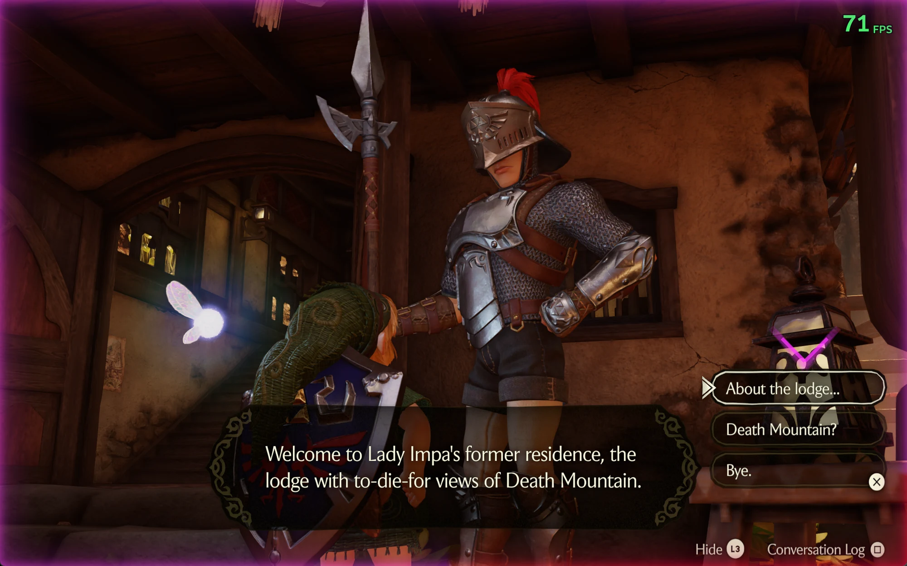
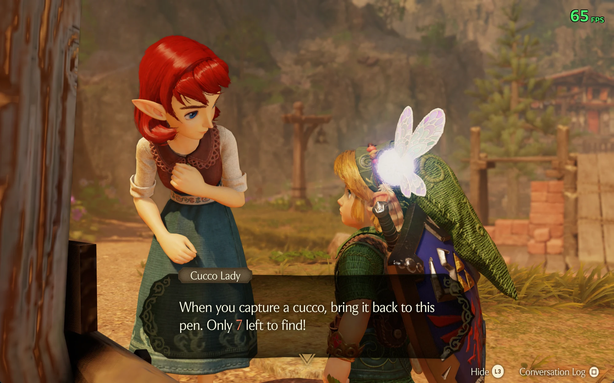

# Longshot-Narrator

[](https://github.com/Predator04/Longshot-Narrator/releases/latest)
[](LICENSE)


**Read-aloud dialogue for [Longshot](https://git.magicbean.dev/MagicBeanDev/Longshot)** — the PC version of *The
Legend of Zelda: Ocarina of Time* (Nintendo Switch 2) that you build from your own copy of the game.

Longshot-Narrator is a source patch. It speaks every dialogue box aloud as it appears, gives each character a voice
that suits them, and reads Link's reply choices in a voice of his own. It was written for a player who cannot read
yet, and it suits anyone who would rather listen.



> [!IMPORTANT]
> This repository contains **no game files, no keys, no executable and no voice recordings**. You need Longshot,
> built from your own copy of the game. All speech is generated on your PC as you play.

---

## Contents

- [What it does](#what-it-does) · [Settings](#settings) · [Requirements](#requirements)
- [Install](#install) · [Using other voices](#using-other-voices-or-your-own) · [Uninstall](#uninstall)
- [How it works](#how-it-works) · [What it changes](#what-it-changes) · [Troubleshooting](#troubleshooting)

---

## What it does

- **Every dialogue box is read aloud** when it appears, page by page.
- **Character voices.** Each character gets a man's, woman's, boy's or girl's voice chosen to match their model, and
  keeps that same voice every time you meet them.
- **Link's voice for the choices.** Reply menus are read in a dedicated Link voice. Only the *highlighted* choice is
  read; moving the cursor stops the current line and reads the one you land on.
- **A rainbow chevron points at a reply menu**, so a player who cannot read can tell the game is asking them
  something rather than still talking.
- **A press-next glow** round the screen's edge once a page has been read, so they know to press on. Both cues can be
  set to one steady colour instead of the rainbow.
- **Numbers the game fills in are spoken** as part of the line — "Only **7** left to find!" — not skipped or read as
  a placeholder.
- **Expression.** Lines ending in `!` sound more excited, questions rise at the end, and `...` pauses.
- **No repeats, and no silence.** A line you just heard is not read again when a conversation loops back to it, but
  talking to someone a second time starts afresh, so you always hear their opening line.
- **The game's own voice acting is left alone.** Where the game voices a line itself, the narrator stays quiet.



## Settings

In the game's menu (**Insert** or **F1**), under the **Audio** tab. Changes take effect immediately.

| Setting | Choices | Default | What it does |
|---|---|---|---|
| **Read aloud** | On / Off | On | Turns read-aloud on or off. |
| **Read-aloud voice** | Natural / Windows / Custom | Natural | *Natural* is the lifelike voice ([Piper](https://github.com/rhasspy/piper), running on your PC). *Windows* is the voice built into Windows, used automatically if Piper isn't installed. *Custom* uses one Piper voice of your own for every line — put its `.onnx` and `.onnx.json` in `piper\custom` next to `longshot.exe`. |
| **Read-aloud speed** | 50% – 200% | 100% | How fast lines are read. |
| **Press-next glow** | Off / Screen edge / Arrow / Both | Both | *Screen edge*: the picture's rim glows once a page has been read. *Arrow*: a chevron points at a reply menu. *Both* does each. |
| **Glow colour** | Rainbow / Gold / Green / Blue / Purple / Pink | Rainbow | *Rainbow* keeps turning through every hue; any other holds one colour still, which is calmer over a long session. (Gold is the subtlest — against sandy scenery like Kakariko it can almost disappear.) |
| **Link's voice** | Voice 1 – 16 | Voice 1 | Which voice reads Link's choices. Changing it plays a sample. |
| **Link's voice pitch** | Normal, +1 – +6 | +3 | How much higher Link's voice is, in semitones, so he sounds younger. Changing it plays a sample. |

Settings are saved in `longshot_options.ini` alongside Longshot's own. Starting the game with `HOS_VOICE=0` turns
read-aloud off entirely.

## Requirements

| | |
|---|---|
| **OS** | Windows (64-bit) |
| **Longshot** | **v3.0.0-rc.3**, built from source — see [Install](#install) |
| **Game** | Your own copy. Nothing here supplies it |
| **Git** | [Git for Windows](https://git-scm.com), to apply the patch |
| **Voices** | [Piper](https://github.com/rhasspy/piper) and two voice models, ~157 MB, fetched by `setup-voices.ps1` |

Without Piper, read-aloud still works using the Windows voice; Piper is what makes it sound natural.

> [!NOTE]
> Longshot has no stable release yet, so this patch is cut against a specific release candidate and will not apply
> to a different one. `install.ps1` tells you which version you are on if it doesn't fit.

---

## Install

### 1. Get Longshot

```powershell
git clone https://git.magicbean.dev/MagicBeanDev/Longshot
cd Longshot
git checkout v3.0.0-rc.3
```

<details>
<summary>Why not GitHub?</summary>

Longshot continues [Hookshot](https://github.com/NotRexed/Hookshot), whose GitHub repository is gone. Longshot is
the same repository under a new name, on Team MagicBean's own server, and it still carries Hookshot's original tags.
</details>

### 2. Add Longshot-Narrator

Download the latest release, unzip it, open PowerShell in that folder and run:

```powershell
powershell -ExecutionPolicy Bypass -File .\install.ps1 -Longshot "C:\path\to\Longshot"
```

It only edits Longshot's source. Nothing is downloaded and no game files are touched. It says so if the add-on is
already installed, or if your Longshot version doesn't match.

### 3. Build Longshot

Build as Longshot's own README describes, for example:

```powershell
python -I nx2/make_game.py --nup "C:\path\your-game.nup" --out "C:\Games\Longshot" --language en-US
```

### 4. Add the natural voices

Point this at your **built game folder** — the one you passed to `--out`, holding `longshot.exe`:

```powershell
powershell -ExecutionPolicy Bypass -File .\setup-voices.ps1 -Game "C:\Games\Longshot"
```

It fetches Piper and both voices (about 157 MB) into `<game>\piper`. Anything already there and the right size is
left alone, so a dropped download is fixed by running it again. Add `-Check` to see what's missing without
downloading anything.

<details>
<summary>Or do it by hand</summary>

1. Download `piper_windows_amd64.zip` from [Piper's releases](https://github.com/rhasspy/piper/releases) (release
   2023.11.14-2). It contains a `piper` folder; unzip it next to `longshot.exe`, so that you have
   `C:\Games\Longshot\piper\piper.exe`.
2. Download these two voices from [rhasspy/piper-voices](https://huggingface.co/rhasspy/piper-voices/tree/main/en/en_US),
   both the `.onnx` file and its `.onnx.json`, into that same `piper` folder:

   | File | Used for | Size |
   |---|---|---|
   | `en_US-lessac-medium.onnx` + `.onnx.json` | the narrator (characters it doesn't recognise) | ~63 MB |
   | `en_US-libritts_r-medium.onnx` + `.onnx.json` | the character voices and Link's | ~79 MB |

</details>

Either way, check each voice's licence on its model card before you use it.

### 5. Play

Start the game and talk to anyone. Settings are under **Insert → Audio**.

---

## How it works

Longshot turns the game's ARM64 code into a native Windows program. Longshot-Narrator lives in the host layer beside
it: a background thread watches the game's own dialogue system and speaks what it finds. It reads the game's memory;
it does not modify the game's logic.

**Finding the text.** The game keeps the message currently on show behind a fixed pointer in `main`'s data. The
narrator polls that object and reads the line's text, its message id, the number of reply choices, and the page
counter, all at known offsets.

**Working out who is speaking.** The message object points at the actor list for the event in progress. Walking that
list and taking the first character entry gives the model's name — `Npc_Hylia_Soldier_001`, say — and the name
selects the voice, so a character sounds the same every time you meet them. Note the list is the *event's* cast, not
the speaker alone: a scene can contain characters who never say a word, and one conversation can have several
speakers.

**Knowing where a conversation begins and ends.** This is the part that needed the most care. The dialogue box shuts
briefly for all sorts of reasons mid-conversation — a camera move, a page change — and the gap looks exactly like
the player walking away and talking again. Timing cannot separate them: measured mid-conversation pauses ran to
2916 ms while deliberate re-talks came in as low as 1406 ms. The page counter settles it. While the box is shut, a
page counter that has dropped to zero means the conversation ended, so the next box starts fresh; a page counter
holding its value means the same conversation is merely paused. That one rule is why an NPC's opening line isn't
repeated when a conversation loops, yet *is* read again when you genuinely talk to them a second time.

**Not repeating itself.** Lines heard recently are kept as a small ring of hashes with timestamps, so a conversation
that loops back doesn't say the same thing twice. The ring is cleared whenever a new conversation starts.

**Filling in numbers.** The game inserts values into text at display time — rupee counts, how many cuccos are left.
A hook reads those from the game's save-data manager so the line is spoken as the player sees it.

**Staying quiet over real voice acting.** The game voices some lines itself. A hook on the game's file opens watches
for its voice streams and silences the narrator for that box, so the two never talk over each other.

**Speaking.** Piper runs as a child process and is fed one sentence at a time, returning raw audio that is queued to
the game's own audio output — so synthesis never blocks the frame. The narrator uses a single-speaker model; the
characters and Link come from a multi-speaker model, with a speaker id chosen per character.

**Reply menus.** Only the highlighted choice is read. Moving the cursor cuts the current line off and reads the new
one once the cursor has rested briefly, so holding a direction doesn't pile up a queue of speech.

**The on-screen cues.** The host sets a single integer exported by the renderer; the Vulkan layer reads it each frame
and draws accordingly — nothing, the edge glow, or the chevron positioned over the reply list. That is the whole
channel between the two halves.

## What it changes

The patch touches nine files. Most of the work is one new file; the rest are small hooks.

| File | What it does |
|---|---|
| `host/oot_voice.c` | **New.** The narrator: polling, speaker lookup, conversation tracking, Piper, the cues |
| `host/oot_voice_cast.h` | **New.** The character-to-voice table |
| `host/nn_fs.c` | Notices the game's own voiced lines so the narrator stays quiet |
| `host/hos_main.c` | Gives the narrator the save-data manager, for filled-in numbers |
| `host/oot_text_size.c` | Keeps text handling in step with the narrator |
| `gpu/vk/vk_api.h` | Option ids for the Audio rows |
| `gpu/vk/vk_menu.h` | The settings themselves |
| `gpu/vk/vk_menu.cpp` | The Audio rows, and drawing the glow and the chevron |
| `gpu/vk/vk_replay.cpp` | Passes the settings from the menu to the host |

`install.ps1 -Uninstall` reverses all of it exactly.

## Using other voices, or your own

Any [Piper](https://github.com/rhasspy/piper) voice can be the narrator. Put its `.onnx` and `.onnx.json` in the
`piper` folder under the narrator model's filename, replacing the originals. That voice then reads every character
the add-on doesn't recognise. For a single voice everywhere, use the **Custom** setting and `piper\custom` instead.

To use **your own voice**, record yourself and train a Piper voice with Piper's
[training guide](https://github.com/rhasspy/piper/blob/master/TRAINING.md) — fine-tuning an existing voice needs far
less audio than training from scratch. Only train on a voice that is yours, or one whose owner agreed.

## Uninstall

```powershell
powershell -ExecutionPolicy Bypass -File .\install.ps1 -Longshot "C:\path\to\Longshot" -Uninstall
```

Then build Longshot again. You can delete the `piper` folder next to `longshot.exe`.

## Troubleshooting

| Symptom | What to check |
|---|---|
| **No speech at all** | **Insert → Audio → Read aloud** is On. Every step writes a line starting with `voice` to `longshot_log.txt` beside the game, including lines it could not read and why. |
| **The Windows voice instead of the natural one** | The log says `no piper\piper.exe beside the game` or `no piper\<voice file>`. Run `setup-voices.ps1 -Check`. |
| **`install.ps1` says the patch doesn't fit** | Your source isn't the supported version. The message names what you are on and what is expected. |
| **The cues don't appear** | Check **Press-next glow** isn't Off, and that **Glow colour** isn't one that blends into the scene. |

## Credits and licence

- Hookshot and its contributors, and [Longshot](https://git.magicbean.dev/MagicBeanDev/Longshot) (Team MagicBean),
  who continue that work. This add-on builds on theirs.
- [Piper](https://github.com/rhasspy/piper) for the natural voices, and the authors of the voice models.

Longshot-Narrator is licensed under the GPL-3.0, the same as Longshot. See [LICENSE](LICENSE). It is not affiliated
with Nintendo, with the Hookshot project, or with Team MagicBean.
