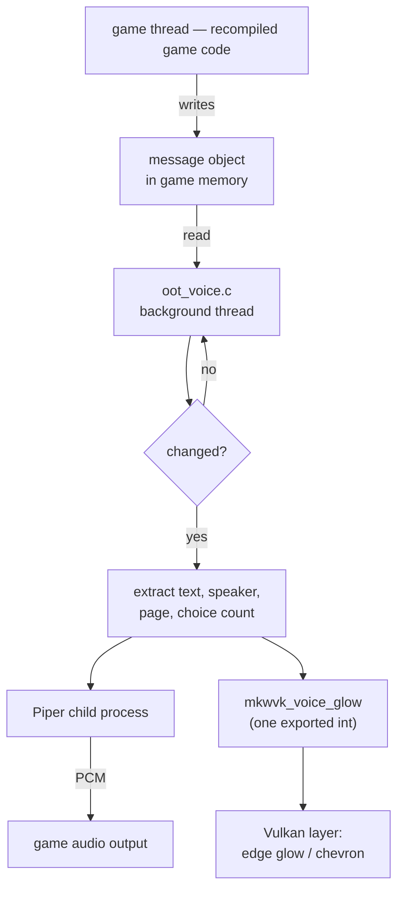

# Architecture

How Longshot-Narrator works, in enough detail to modify it or port it to a new Longshot version.

If you only want to use the add-on, the [README](../README.md) is enough.

---

## Contents

- [The problem](#the-problem)
- [Where the code lives](#where-the-code-lives)
- [The polling loop](#the-polling-loop)
- [Reading the dialogue box](#reading-the-dialogue-box)
- [Who is speaking](#who-is-speaking)
- [Conversation boundaries](#conversation-boundaries)
- [Not repeating itself](#not-repeating-itself)
- [Values the game fills in](#values-the-game-fills-in)
- [Staying quiet over real voice acting](#staying-quiet-over-real-voice-acting)
- [Speech](#speech)
- [Reply menus](#reply-menus)
- [The on-screen cues](#the-on-screen-cues)
- [Settings](#settings)
- [Porting to a new Longshot version](#porting-to-a-new-longshot-version)

---

## The problem

Longshot translates the game's original ARM64 code into C, compiles it, and runs it natively on Windows with a
Vulkan renderer standing in for the console's graphics API. The game's own logic is therefore intact and
unmodified — it is the *same program*, recompiled.

That is the opportunity and the constraint. The dialogue system is the game's, untouched, and it does not announce
anything. There is no event to subscribe to and no text callback to hook. The add-on has to **observe** the running
game: find the structure the dialogue system uses, watch it change, and react.

It does not alter the game's behaviour. Every change it makes is additive and lives in the host layer beside the
recompiled code.

## Where the code lives

```
host/oot_voice.c          the narrator: polling, voices, speech, cue flags   (~970 lines)
host/oot_voice_cast.h     the character-to-voice table
host/nn_fs.c              hook: notices the game's own voiced lines
host/hos_main.c           hook: hands over the save-data manager
host/oot_text_size.c      keeps text handling in step
gpu/vk/vk_api.h           option ids for the Audio rows
gpu/vk/vk_menu.h          the settings themselves
gpu/vk/vk_menu.cpp        the Audio rows, and drawing the cues
gpu/vk/vk_replay.cpp      passes settings from the menu to the host
```

Nearly all the work is in `oot_voice.c`. The rest are a few lines each.

## The polling loop



A thread of the add-on's own polls the game's state. It never blocks the game thread and never blocks the frame:
the only thing it writes that the renderer reads is a single integer.

## Reading the dialogue box

The game keeps the message currently on show behind a fixed pointer in `main`'s data (`MSG_HOLDER` in
`oot_voice.c`). Dereferencing it gives the message object, and the fields the add-on needs sit at known offsets:

| What | Where | Notes |
|---|---|---|
| Message id | `+0x30` | `0xffffffff` when no box is up |
| Choice count | `+4` | 0 when the box is not a reply menu |
| Actor list | `+0x28` | the event's cast — see below |
| Page counter | — | which page of a multi-page message is showing |

These offsets are properties of the **game**, not of Longshot: they come from the original program's data
structures. They are stable as long as the game version is the one Longshot supports. A different game update would
move them; a new Longshot release would not.

## Who is speaking

The message object points at the actor list for the event in progress. Entries are a fixed stride apart, each
carrying a name at a known offset. Walking the list and taking the first character entry gives a model name such as
`Npc_Hylia_Soldier_001`, and that name selects a voice from `oot_voice_cast.h`, so a character sounds the same every
time you meet them.

Two things to know before you rely on this:

- **It is the event's cast, not the speaker.** A scene may list characters who never say a word. One conversation
  can also have several speakers — a scene with three characters talking shares one cast.
- **Only character entries count.** Scenery entries appear in the same list, and their names are volatile and can
  repeat within one set, so they are skipped.

A character the table does not know gets the narrator voice rather than silence.

## Conversation boundaries

This is the part that needed the most care, and the part most likely to break if you change it.

The add-on must know when one conversation ends and another begins, because that is what decides whether a line is
"already heard" or should be read fresh. The obvious approach — treat a long enough gap as a new conversation —
**does not work**. The dialogue box closes briefly mid-conversation for ordinary reasons: a camera move, a page
change, an animation. Measured on real play:

| | |
|---|---|
| Longest gap *within* one conversation | **2916 ms** |
| Shortest gap *between* two conversations | **1406 ms** |

The ranges overlap, so no threshold separates them. Timing is the wrong signal.

**The page counter is the right one.** While the box is shut:

- page counter has dropped to **0** → the conversation ended. The next box starts fresh.
- page counter **holds its value** → the same conversation is merely paused, and will resume at the next page.

That single rule is why an opening line is not repeated when a conversation loops back to it, yet *is* read again
when you genuinely walk away and talk to the character a second time.

## Not repeating itself

Lines heard recently are kept as a small ring of hashes with timestamps. A line matching one heard within the last
20 seconds is not read again. The ring is cleared whenever a new conversation starts, which is what makes a
deliberate re-talk say the opening line again.

## Values the game fills in

The game inserts values into text when it displays it — rupee counts, how many of something remain. Read naively,
the line would be spoken with a placeholder or a stale number.

`hos_main.c` passes the add-on the game's save-data manager, and the add-on resolves those values so the sentence is
spoken as the player sees it: *"Only **7** left to find!"*

## Staying quiet over real voice acting

Some lines the game voices itself. Reading those aloud would talk over the actor.

`nn_fs.c` watches the game's file opens. When it sees the game open one of its own voice streams, it records the
time, and the narrator stays quiet for that box. This is a hook on a path the game takes anyway, so it costs
nothing when no voiced line is playing.

## Speech

Two engines:

- **Piper** (default). Runs as a **child process**, fed one sentence at a time over stdin as JSON and returning raw
  PCM. Because it is a separate process, synthesis never blocks the game's frame — the audio is queued to the
  game's own output when it arrives.
- **Windows' built-in voice** (SAPI), used automatically when Piper is not installed. Always initialised, so it is
  available as a fallback even when Piper is the active engine.

Piper uses two models: a single-speaker model for the narrator, and a multi-speaker model for the characters and
Link, with a speaker id chosen per character. That is how one download supplies many distinct voices.

Expression is applied to the text before synthesis: `!` raises energy, a question mark lifts the end of the line,
`...` becomes a pause.

> **A log line that looks like a fault and is not:** `read-aloud ready (Windows voice, …)` appears at startup even
> when Piper is working. It reports that the SAPI fallback is initialised. Piper is started lazily, per line.

## Reply menus

Only the **highlighted** choice is read, not the whole list — reading every option takes far too long and buries
the one the cursor is on.

Moving the cursor stops the current line immediately and reads the new one, but only after the cursor has rested
briefly (a fraction of a second). Without that rest, holding a direction would queue a line per row and the speech
would run long after the player had stopped moving.

## The on-screen cues

The host and the renderer communicate through exactly one value: an integer exported by the Vulkan back end
(`mkwvk_voice_glow`), which the host locates at runtime and writes.

| Value | Meaning | Drawn |
|---|---|---|
| `0` | nothing to show | — |
| `1` | the page has been read | edge glow |
| `0x100 \| choices << 4 \| cursor` | a reply menu is waiting | chevron over the list, positioned from the choice count |

The renderer reads it once a frame. The chevron's position is derived from the number of choices, because the game
lays the list out from the bottom up.

This is deliberately the whole interface. The renderer knows nothing about dialogue, and the host knows nothing
about drawing.

## Settings

Settings are ordinary rows in the game's own Insert menu, under **Audio**. Their ini keys are derived from the row
labels, so **renaming a row orphans everyone's saved setting** for it — don't, unless you mean to.

Option ids live in `vk_api.h`. They must not collide with the host project's own; the add-on uses a block clear of
them, and the comment there records which ids upstream has reserved.

## Porting to a new Longshot version

The add-on is a patch, so a new Longshot release can move the code it patches. In practice:

1. Check out the new tag and apply the patch with `git apply --3way`. Most hunks land; the conflicts are usually
   *adjacency* — upstream added code next to ours — and resolve by keeping both sides.
2. **The renderer DLL's name matters.** The host locates the cue flag by module name. If that name changes, the
   narrator will speak normally while every cue silently does nothing — the worst kind of failure, because it looks
   like it works.
3. **Check the option ids** in `vk_api.h` have not been claimed upstream.
4. The game-side offsets (message object, actor list) do **not** change with a Longshot release. They change with a
   *game* version.
5. Build, then confirm in `longshot_log.txt` that a `voice: message object 0x…` line shows a real pointer. A zero
   there means the dialogue structure was not found and nothing else will work.
